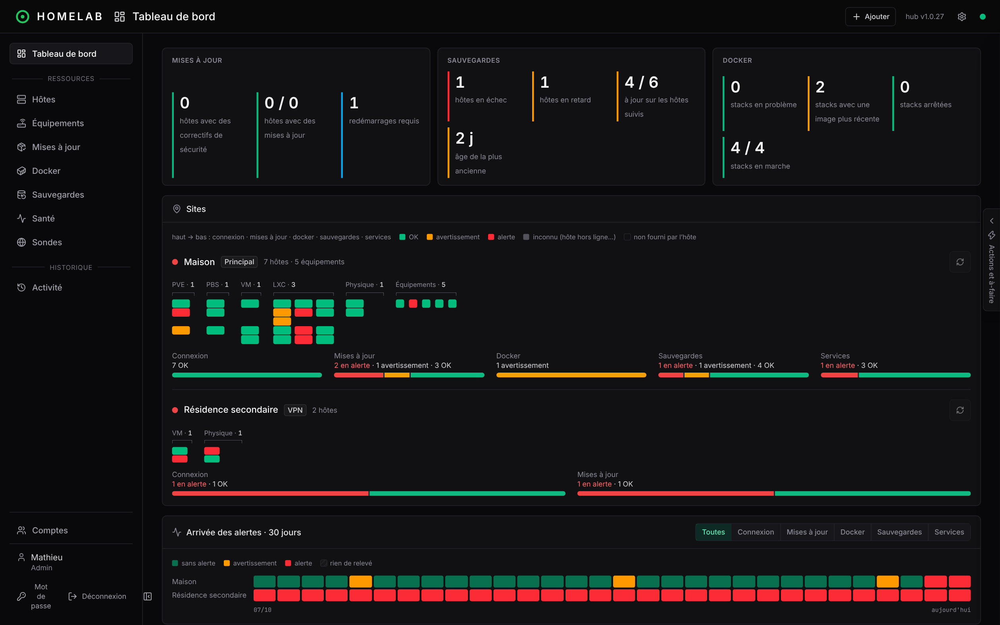
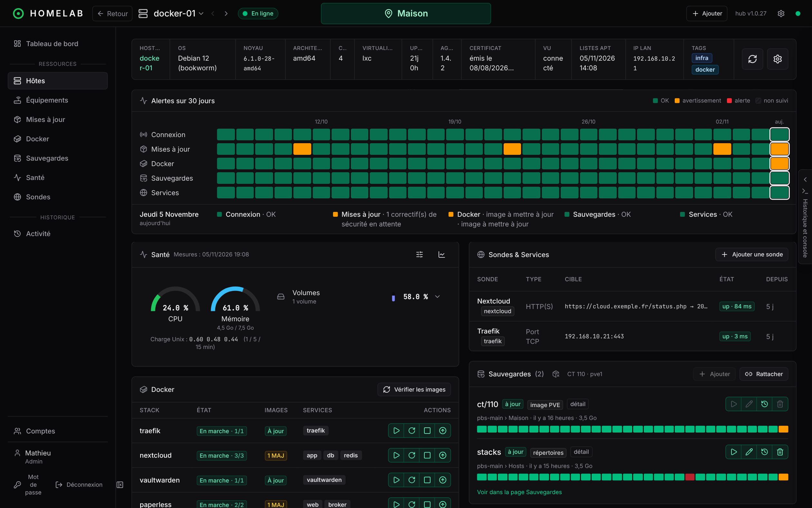
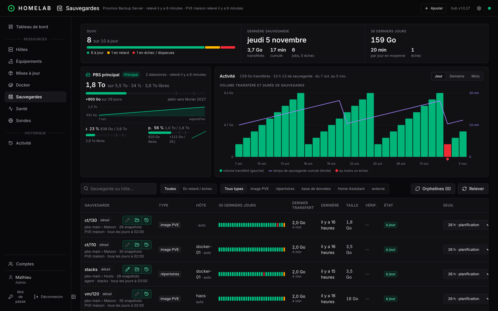
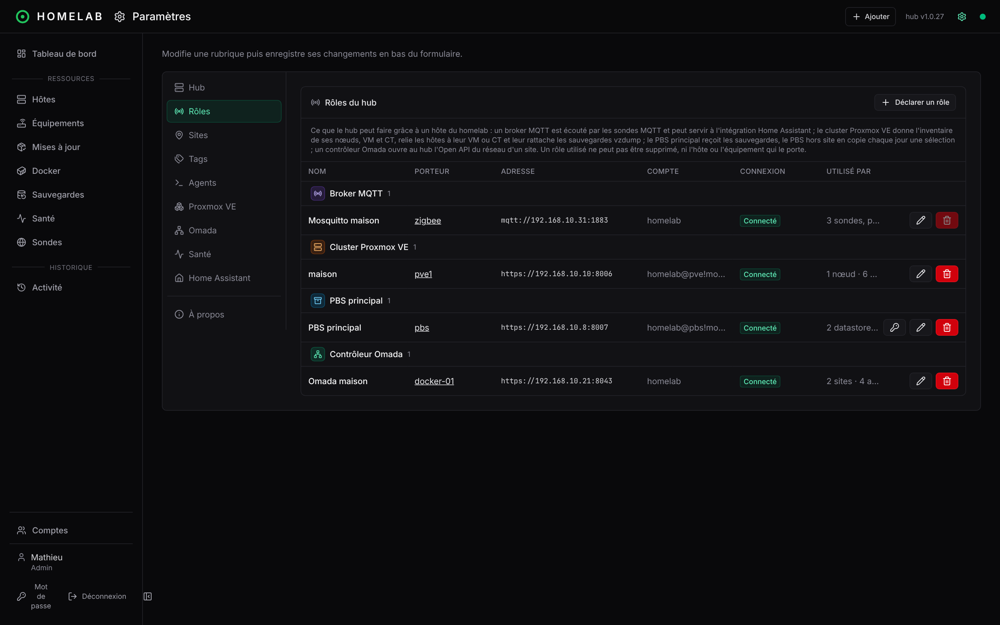
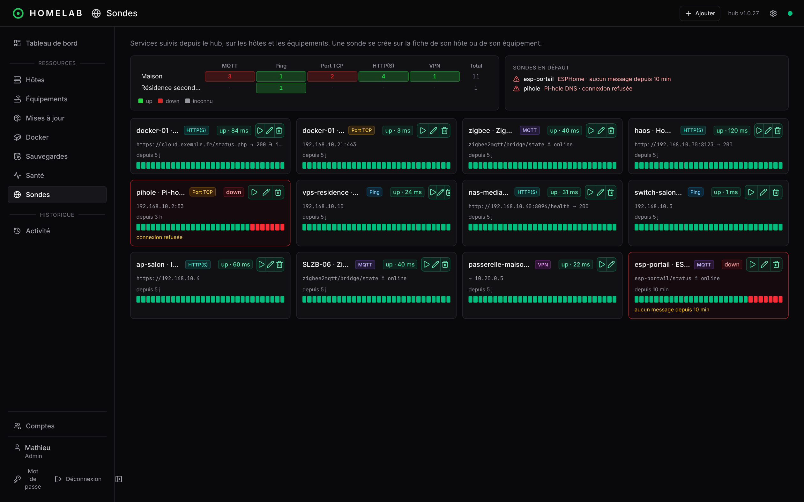

# Homelab Manager

**Une seule interface pour savoir si ton homelab va bien** : état des machines, mises à jour, Docker, **sauvegardes**, services et équipements réseau, avec des alertes qui disent quoi, où et depuis quand.

Pensé pour le réseau local : un **hub** en conteneur, un **agent** léger par machine, aucun port à ouvrir sur les hôtes.



## Ce que tu y gagnes

- **Un tableau de bord par site** : une colonne par hôte, un carré par domaine (connexion, mises à jour, Docker, sauvegardes, services, onduleur…). Le pire état remonte de l'élément à l'hôte, puis au site.
- **Mises à jour sous contrôle** : correctifs de sécurité, paquets en retard sur 14 hôtes, redémarrage requis ; on met à jour un hôte, une sélection ou « openssl partout » en un clic, logs en direct.
- **Docker** : stacks compose découvertes toutes seules, santé des conteneurs, images à mettre à jour vérifiées sans rien télécharger, démarrer / arrêter / mettre à jour, logs et fichiers compose.
- **Sauvegardes suivies de bout en bout** : Proxmox VE (jobs vzdump), Proxmox Backup Server, **Home Assistant OS**, répertoires et bases (PostgreSQL, MongoDB) pilotés par les agents, copie hors site. Chaque sauvegarde est **rattachée à sa machine**, jugée sur sa vraie planification, et alertée si elle est en retard ou en échec. [Comment ça marche](docs/suivi-des-sauvegardes.md).
- **Sondes de service** : ping, port TCP, page HTTP, message MQTT (Zigbee2MQTT, ESPHome), tunnels VPN site à site : on vérifie que le service **répond**, pas seulement que la machine est allumée.
- **Équipements sans agent** : switch, point d'accès, passerelle, coordinateur Zigbee, module ESPHome, suivis par leurs sondes ; synchronisation automatique depuis un contrôleur Omada.
- **Santé** : CPU, mémoire, charge, volumes, SMART, RAID, onduleur (NUT), avec seuils.
- **Home Assistant** (option) : appareils, alertes et mises à jour publiés en MQTT avec découverte automatique.
- **Sécurisé et simple** : TLS avec un certificat par agent, commande d'installation à usage unique, binaires signés, trois profils (admin, operator, viewer), clés d'API. Interface dark, en français, utilisable sur mobile.

| Fiche hôte | Sauvegardes |
| --- | --- |
|  |  |

| Rôles du hub | Sondes |
| --- | --- |
|  |  |

## Démarrage rapide

**1. Lance le hub** (Docker et Docker Compose) :

```sh
curl -fsSLO https://raw.githubusercontent.com/Mamath2000/homelab-manager/main/compose.yml
docker compose up -d
docker compose logs hub      # mot de passe temporaire du compte « superadmin »
```

Ouvre `http://<ip-du-hub>:3000`, connecte-toi en `superadmin`, et crée ton compte `admin` dans la page **Comptes**.

**2. Ajoute un hôte** : bouton **Ajouter un hôte**, puis copie la commande affichée et lance-la en root sur la machine (Debian / Ubuntu avec systemd, `curl`). L'hôte passe **En ligne** quelques secondes plus tard. Home Assistant OS, Unraid, WSL2 et Windows ont leur propre méthode : [Installation](docs/installation.md).

**3. Branche tes sauvegardes** : dans **Paramètres › Rôles**, déclare le **PBS principal** et ton **cluster Proxmox VE** ; les jetons sont créés par les agents, rien n'est à copier. Les sauvegardes apparaissent, rattachées à leurs hôtes.

Un cas complet, de la première commande à la première alerte, est détaillé dans le **[Démarrage rapide](docs/demarrage-rapide.md)**.

## Se repérer

| Mot | Sens |
| --- | --- |
| **Hub** / **agent** | l'application / le petit binaire installé sur chaque machine |
| **Hôte** / **équipement** | une machine avec agent / un appareil suivi sans agent |
| **Site**, **tag** | où est la machine, comment la filtrer |
| **Rôle** | ce que le hub fait au travers d'un hôte : suivre un PBS ou un cluster Proxmox, écouter un broker MQTT, synchroniser Omada |
| **Profil** | les droits d'un compte : `admin`, `operator`, `viewer` |
| **Sonde** | une vérification de service faite depuis le hub (ou un hôte) |

Détails : [Les notions clés](docs/concepts.md). Tout ce qu'on peut créer, avec son chemin dans l'interface : [Créer des éléments](docs/creer-des-elements.md).

## Configuration

Les variables d'environnement se règlent dans [`compose.yml`](compose.yml) ; la plupart des réglages se font ensuite dans l'interface (**Paramètres**).

| Variable | Défaut | Rôle |
| --- | --- | --- |
| `MONGO_URL` | `mongodb://mongo:27017/homelab` | Base MongoDB |
| `PORT` / `AGENT_TLS_PORT` | `3000` / `3443` | Ports de l'interface et des agents (TLS) |
| `TZ` | `Europe/Paris` | Fuseau du hub (sauvegardes de répertoires) |
| `LOG_LEVEL` | `info` | Niveau de logs |
| `SESSION_DAYS` | `30` | Durée des sessions |
| `COOKIE_SECURE` / `TRUST_PROXY` | `false` | `true` derrière un reverse proxy HTTPS |
| `FEATURE_STANDARDISATION` | `false` | Active la standardisation des hôtes |
| `FEATURE_BACKUP_NEXTCLOUD_AIO` | `false` | Affiche le plugin Nextcloud AIO |

Reverse proxy, URL du hub, adresse donnée aux agents : [Configuration](docs/configuration.md). Sur Home Assistant OS, un add-on autonome (MongoDB intégrée) est proposé par [Homelab Manager HAOS](https://github.com/Mamath2000/homelab-manager-haos).

## Sécurité

Pensé pour rester sur le LAN : ne l'expose pas sur Internet sans reverse proxy HTTPS et authentification supplémentaire. Les agents n'exécutent qu'une **liste fixe d'actions**, avec des paramètres contrôlés ; leur connexion est protégée par la clé du hub épinglée, un code d'installation à usage unique et un certificat par agent, révocable en un clic. Le hub reste l'équivalent d'un accès root sur le parc : à protéger comme tel. Voir [Sécurité](docs/securite.md) et l'[audit de sécurité](docs/audit-securite.md).

## Documentation

| Pour… | Lire |
| --- | --- |
| Démarrer | [Démarrage rapide](docs/demarrage-rapide.md) · [Installation](docs/installation.md) · [Configuration](docs/configuration.md) |
| Comprendre | [Notions clés](docs/concepts.md) · [Alertes et statuts](docs/alertes.md) · [Créer des éléments](docs/creer-des-elements.md) |
| Sauvegardes | [Suivi des sauvegardes](docs/suivi-des-sauvegardes.md) · [Sauvegardes](docs/sauvegardes.md) · [Proxmox VE](docs/proxmox-ve.md) |
| Surveiller | [Sondes](docs/sondes.md) · [Équipements](docs/equipements.md) · [Docker](docs/docker.md) · [Santé](docs/sante.md) · [Onduleur](docs/onduleur.md) |
| Administrer | [Rôles du hub](docs/roles.md) · [Comptes et profils](docs/comptes.md) · [Standardisation](docs/standardisation.md) · [Sécurité](docs/securite.md) · [Audit de sécurité](docs/audit-securite.md) |
| Intégrer | [Home Assistant](docs/home-assistant.md) · [API et clés d'API](docs/api.md) |
| Contribuer | [Développement et architecture](docs/developpement.md) · [Changelog](CHANGELOG.md) |
