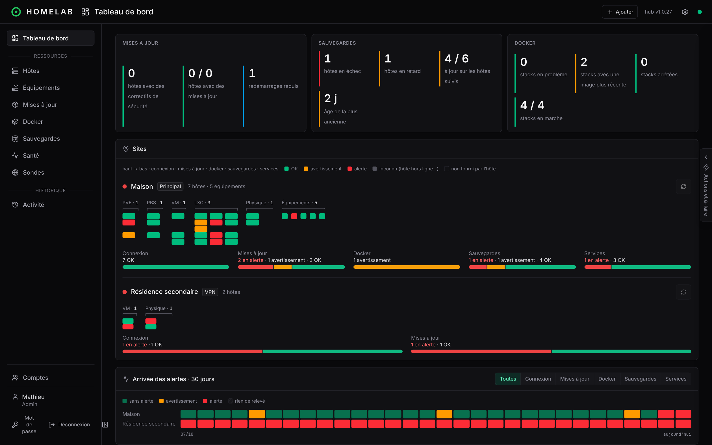
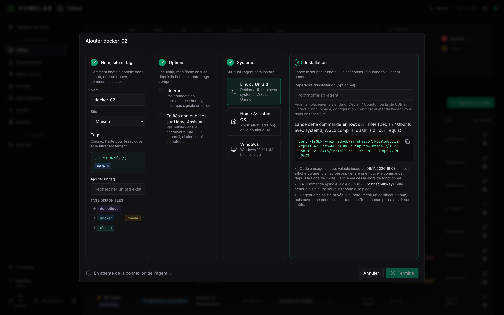
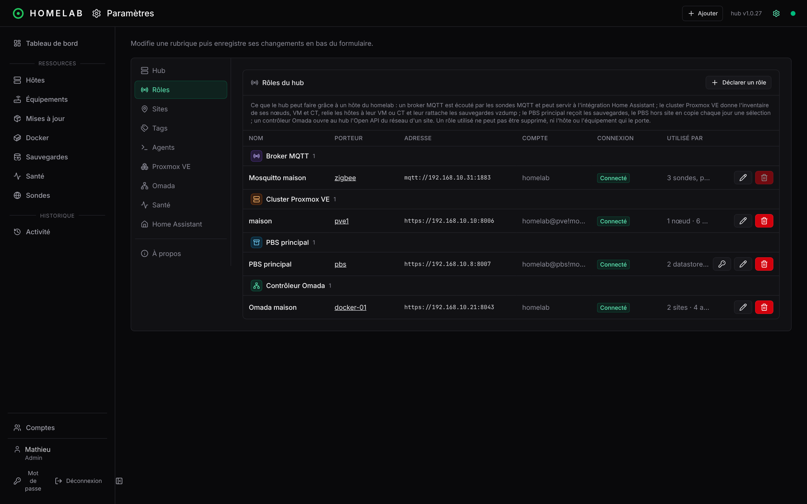
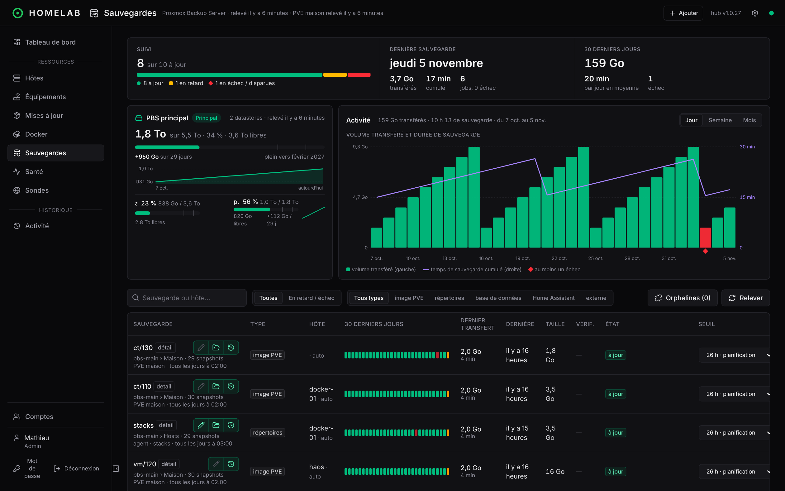
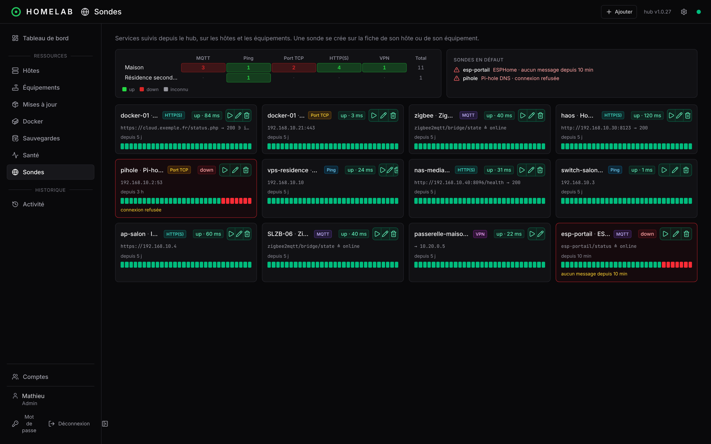

# Démarrage rapide

Un homelab type, mis sous surveillance en une trentaine de minutes. Le fil rouge :

| Machine | Rôle dans l'exemple |
|---|---|
| `pve1` | nœud Proxmox VE qui héberge tout le reste |
| `docker-01` | CT Debian avec quelques stacks compose |
| `pbs` | Proxmox Backup Server (CT ou VM) |
| `haos` | VM Home Assistant OS |
| `switch-salon` | switch administrable, sans agent |

À la fin, le tableau de bord montre l'état de chacun, les sauvegardes de `docker-01` et de `haos` sont suivies, et un retard de sauvegarde déclenche une alerte.



## 1. Lancer le hub (5 min)

Sur une machine toujours allumée avec Docker (ici `docker-01`) :

```bash
mkdir homelab-manager && cd homelab-manager
curl -fsSLO https://raw.githubusercontent.com/Mamath2000/homelab-manager/main/compose.yml
docker compose up -d
docker compose logs hub          # affiche le mot de passe temporaire de « superadmin »
```

Ouvre `http://<ip>:3000`, connecte-toi en `superadmin`, puis ouvre la page **Comptes** pour créer ton compte `admin`. Le mot de passe temporaire que tu reçois est à changer à la première connexion, et `superadmin` ne sert plus qu'au dépannage. Détails : [Installation](installation.md) et [Comptes et profils](comptes.md).

## 2. Décrire ses sites et ses tags (2 min)

**Paramètres › Sites** : crée un site « Maison » (type **Principal**). **Paramètres › Tags** : crée `infra`, `domotique`, `docker`. Les sites regroupent les hôtes dans le tableau de bord, les tags servent de filtres.

## 3. Enrôler les premiers hôtes (10 min)

Pour chaque machine Linux (`pve1`, `docker-01`, `pbs`) :

1. **Ajouter un hôte** (bouton vert en haut à droite) : nom, site, tags.
2. Copie la commande affichée et lance-la **en root** sur la machine.
3. Quelques secondes plus tard l'hôte passe **En ligne** et remonte son système, ses mises à jour APT et ses stacks Docker.



Pour `haos`, l'agent est une application Home Assistant : voir [Installation › Home Assistant OS](installation.md#home-assistant-os). Pour les CT et VM de `pve1`, une fois le cluster déclaré (étape 4), l'agent peut aussi s'installer depuis l'inventaire Proxmox VE, sans rien copier.

## 4. Déclarer Proxmox et le PBS (10 min)

C'est ce qui permet à Homelab Manager de **suivre les sauvegardes**. Dans **Paramètres › Rôles › Déclarer un rôle** :

1. **PBS principal** : choisis l'hôte `pbs`, **Détecter**, **Créer le jeton**, **Tester**. L'agent du PBS crée lui-même les jetons : rien à copier à la main.
2. **Cluster Proxmox VE** : choisis l'hôte `pve1`, **Détecter**, choisis l'interface que le hub joint, **Créer le jeton** (lecture seule, `PVEAuditor`), **Tester**.



En quelques minutes, le hub relève le cluster (guests, jobs vzdump) et le PBS (groupes et snapshots), puis **rattache chaque sauvegarde à son hôte** par l'adresse MAC. Les VM et CT qui ont un agent voient apparaître leur carte **Sauvegardes** ; un guest qu'aucun job ne couvre est signalé. Le principe complet est dans [Suivi des sauvegardes](suivi-des-sauvegardes.md).

## 5. Sauvegarder `docker-01` (3 min)

Sur la fiche de `docker-01`, carte **Sauvegardes › + Sauvegarde** : installe le client PBS (un clic), **Créer le jeton** de l'hôte, puis **Ajouter** une sauvegarde de répertoires (`/opt/stacks`, planification `03:00`). L'agent l'exécute lui-même, le PBS la confirme, et la page **Sauvegardes** affiche la ligne avec sa frise sur 30 jours.



Pour `haos`, rien à configurer : l'agent lit les sauvegardes automatiques de Home Assistant, destination par destination.

## 6. Ajouter un équipement et une sonde (3 min)

**Équipements › Ajouter un équipement** : `switch-salon`, type *Switch*, son adresse IP, case **créer une sonde ping** cochée. Sur la fiche de `docker-01`, panneau **Sondes › Ajouter une sonde** : un test HTTP sur l'interface d'une de ses stacks. Le domaine **Services** apparaît, un carré par sonde.



## 7. Lire le résultat

- **Tableau de bord** : une colonne par hôte, un carré par domaine (connexion, mises à jour, Docker, sauvegardes, services…). Le pire niveau remonte à l'hôte puis au site : voir [Alertes et statuts](alertes.md).
- **Sauvegardes › en retard** : filtre rapide sur ce qui demande une action.
- **Frise de 30 jours** sur la fiche de chaque hôte : quand et pourquoi une alerte s'est produite.

Pour voir une alerte, désactive un job de sauvegarde dans Proxmox : la ligne passe en **job désactivé**, puis en **retard** une fois la dernière échéance dépassée de plus de 2 h, l'hôte en alerte, et son site aussi.

## Et ensuite ?

- Recevoir les alertes dans Home Assistant : [Home Assistant](home-assistant.md).
- Copier les sauvegardes importantes vers un second PBS : [Copie déportée](sauvegardes.md#copie-déportée-pbs-de-secours).
- Inviter d'autres comptes avec le bon profil : [Comptes et profils](comptes.md).
- Tout ce qu'on peut créer, avec le chemin dans l'interface : [Créer des éléments](creer-des-elements.md).
