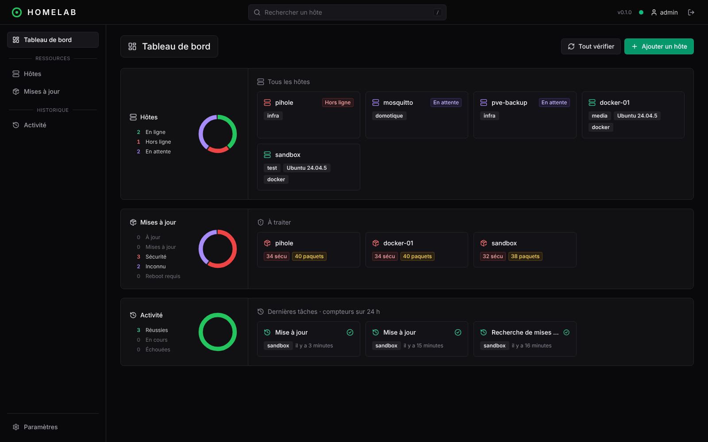

# Homelab Manager

Interface unique pour administrer les serveurs, VM et LXC du homelab. Un **hub** (conteneur Docker) centralise l'état des hôtes ; un **agent** léger installé sur chaque hôte le tient à jour et exécute les actions demandées depuis l'interface.

## Ce que fait la version actuelle

- **Tableau de bord par site** : un carré par hôte, regroupé par site, moitié haute pour les mises à jour, moitié basse pour la sauvegarde ; chiffres clés (correctifs de sécurité, sauvegardes en échec ou en retard), jauges par site, arrivée des alertes sur 30 jours (une ligne par site), actions sur tous les hôtes concernés (correctifs de sécurité seuls, tout APT, images Docker, agents, standardisation, avec confirmation listant les cibles) et listes « à traiter ». Les sites se décrivent dans **Paramètres › Sites et tags** (nom, type Principal / VPN / Externe, ordre d'affichage ; les sites externes d'un seul hôte sont réunis dans une carte) et chaque hôte choisit le sien dans sa fiche.
- **Tags** : plusieurs par hôte, avec une couleur choisie à leur création (depuis la fiche de l'hôte) ; renommés, recolorés ou supprimés dans **Paramètres › Sites et tags**. Filtres par site et par tag sur la page Hôtes. Les groupes des versions précédentes sont devenus des tags.
- **Inventaire** : OS, noyau, architecture, virtualisation (LXC, KVM…), IP, uptime, état de connexion en temps réel.
- **Mises à jour APT** : paquets à mettre à jour, mises à jour de sécurité, paquets bloqués (`hold`), redémarrage requis, ancienneté des listes de paquets.
- **Actions** : `apt-get update`, mise à jour complète ou de paquets choisis, sur un hôte ou plusieurs à la fois, avec les logs en direct.
- **Vue par paquet** : voir sur quels hôtes un paquet est en retard et le mettre à jour partout en un clic.
- **Vérification planifiée** : `apt-get update` automatique toutes les 12 h.
- **Nettoyage** : paquets inutiles (anciens noyaux, dépendances orphelines) supprimables via `apt autoremove`.
- **Historique** des tâches et de leurs sorties (90 jours).
- **Fiche hôte** : bandeau système et frise des alertes des 30 derniers jours (mises à jour, Docker, sauvegardes : pire situation de chaque jour, détail au clic) en tête de page ; sur grand écran, l'historique et la console en direct restent visibles à droite, et toute tâche lancée depuis la fiche s'y affiche.
- **Docker** : stacks compose des hôtes, état des conteneurs, images à mettre à jour, démarrer / arrêter / redémarrer / mettre à jour, logs et fichiers compose.
- **Home Assistant** (option) : appareils, alertes et mises à jour publiés via MQTT, avec découverte automatique.

## Principes

- **Réseau local uniquement** : rien n'est exposé sur Internet, aucun port à ouvrir sur les hôtes (l'agent se connecte au hub, pas l'inverse).
- **Déploiement simple** : un `docker compose` pour le hub, une commande à copier pour chaque agent.
- **Pas de commande arbitraire** : l'agent n'exécute qu'une liste fixe d'actions.
- **Échanges protégés** : connexion des agents en TLS avec un certificat par agent, commande d'installation à usage unique, agents signés (voir [Sécurité](securite.md)).

## Pages

- [Installation](installation.md) : hub et agents.
- [Configuration](configuration.md) : variables d'environnement, reverse proxy, données.
- [Docker](docker.md) : stacks compose, mises à jour des images, actions, logs.
- [Home Assistant](home-assistant.md) : intégration MQTT avec découverte automatique.
- [Comptes et rôles](comptes.md) : premier démarrage, rôles, mots de passe.
- [Sécurité](securite.md) : connexion des agents, enrôlement, révocation, signature des binaires.
