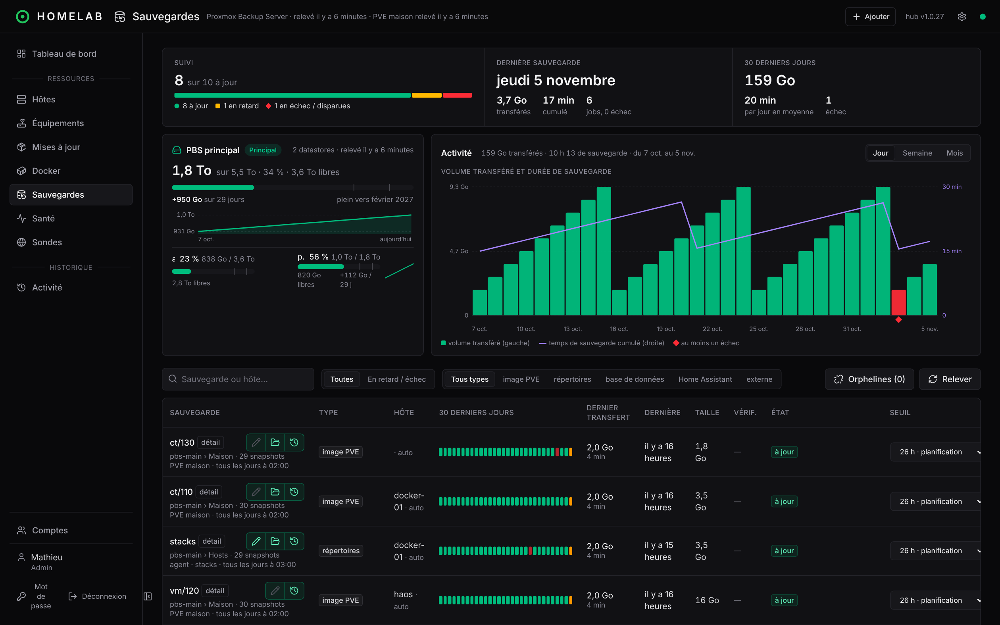

# Suivi des sauvegardes

Homelab Manager **ne sauvegarde pas à ta place** (sauf pour les répertoires et bases que tu lui confies) : il **vérifie que tes sauvegardes existent, sont à jour et se sont bien passées**, machine par machine. Cette page explique d'où viennent les informations ; les réglages sont dans [Sauvegardes](sauvegardes.md).



## Trois sources, une seule vue

```
Proxmox VE (API, lecture seule)  ─┐  jobs vzdump, tâches, guests + adresses MAC
Proxmox Backup Server (API)      ─┼─►  hub ──► ligne par sauvegarde ──► hôte ──► site
Home Assistant OS (agent)        ─┘  sauvegardes automatiques de HA, par destination
```

| Source | Ce que le hub lit | Comment il le lit |
|---|---|---|
| **Proxmox VE** | les jobs de sauvegarde (planification, guests couverts, stockage cible), le résultat de chaque tâche vzdump par guest, les adresses MAC de chaque VM et CT | jeton **`PVEAuditor`** en lecture seule, créé par l'agent d'un nœud ; relevé toutes les 15 min |
| **Proxmox Backup Server** | datastores et occupation, groupes et snapshots, vérifications, tâches (volume transféré et durée) | jeton de supervision en lecture seule, créé par l'agent du PBS ; relevé toutes les 15 min et après chaque sauvegarde de répertoires |
| **Home Assistant OS** | les sauvegardes de Home Assistant, **une ligne par destination** (stockage local, SFTP, Google Drive…), leur planification et leur dernier échec | l'application Homelab Manager Agent de la VM, par l'API de Home Assistant, en lecture seule ; le mot de passe des sauvegardes n'est ni gardé ni envoyé |

Les sauvegardes que **tu crées** dans Homelab Manager (répertoires, PostgreSQL, MongoDB) sont lancées par l'agent de l'hôte et confirmées par le PBS : le hub définit, l'agent exécute, le PBS atteste.

## Le rattachement aux hôtes

Une sauvegarde utile est une sauvegarde **rattachée à la machine qu'elle protège**. C'est automatique :

- **VM et CT Proxmox** : si l'adresse MAC de l'agent est celle d'**un seul** guest du cluster, l'hôte est lié à ce guest. Les groupes que les jobs vzdump de ce guest écrivent sur le PBS (`ct/<id>`, `vm/<id>`) lui sont alors rattachés. C'est ce qui permet de lire « `docker-01` : sauvegardé hier à 02:00 » sur la fiche de l'hôte.
- **Home Assistant OS** : l'agent est dans la VM, donc l'hôte `haos` a sa MAC. Ses sauvegardes se rattachent comme celles de n'importe quelle VM, et celles de Home Assistant (sa propre planification) se lisent à côté de l'image vzdump.
- **Sauvegardes de l'agent** : le hub a créé le job, il connaît son groupe.
- **Sauvegardes d'un script maison** : rattachement manuel depuis la fiche de l'hôte (**Rattacher**) ; sans planification connue, le retard est jugé sur le rythme appris.

Un guest lié qu'**aucun job actif ne couvre** déclenche l'alerte « couvert par aucun job de sauvegarde Proxmox » : on voit un oubli avant d'en avoir besoin.

## Ce que le hub juge

Chaque ligne a un état, calculé contre la **planification réelle** :

| État | Signification |
|---|---|
| **à jour** | un snapshot existe pour la dernière échéance |
| **en retard** | pas de snapshot depuis l'échéance, marge de 2 h comprise, ou « jamais sauvegardée » |
| **dernière exécution en échec** | la dernière tâche vzdump (ou exécution de l'agent, ou sauvegarde automatique de HA) a échoué |
| **job désactivé** | le job qui l'alimente est désactivé |
| **vérification en échec** | le *verify job* du PBS a rejeté le snapshot |
| **disparue du PBS** | le groupe n'existe plus |

Le seuil de retard vient, par ordre de préférence, de la **planification** du job (Proxmox, agent, Home Assistant), puis du **rythme appris** des snapshots, puis de la **rétention** du PBS. Une valeur manuelle est possible par sauvegarde. Sans aucune de ces sources, la sauvegarde n'est jamais en retard : ce « jamais » est affiché, pas silencieux. Voir [Retard](sauvegardes.md#retard).

« En échec » est une **alerte** (rouge), « en retard » un **avertissement** (orange). Ils remontent dans le domaine **Sauvegardes** de l'hôte, puis du site, et dans Home Assistant.

## Où le voir

- **Page Sauvegardes** : compteurs, espace des datastores, une ligne par sauvegarde (type, hôte, frise de 30 jours, dernière, taille, vérification, état, seuil, copie déportée). Filtres *en retard / échec*, type, hôte. Le bouton **Relever** force un relevé complet.
- **Fiche hôte › Sauvegardes** : ce qui protège cette machine, et le guest Proxmox lié.
- **Tableau de bord** : la moitié basse du carré de chaque hôte, les chiffres clés et la liste « Sauvegardes à surveiller ».
- **Volume transféré** : le volume réellement envoyé au PBS par jour et le temps de sauvegarde, sur 30 ou 60 jours.
- **Snapshots** : l'icône en couches ouvre l'historique d'une sauvegarde (date, taille, vérification, note).

## Aller plus loin

- **Copie hors site** : un second PBS, distant, **tire** les sauvegardes choisies du PBS principal ; ni le hub ni un PBS principal compromis ne peuvent les effacer. Le hub suit chaque copie sur une seconde voie de la frise ([Copie déportée](sauvegardes.md#copie-déportée-pbs-de-secours)).
- **Monter un snapshot en lecture seule** sur un hôte pour récupérer un fichier ([Monter une sauvegarde](sauvegardes.md#monter-une-sauvegarde-lecture-seule)).
- **Home Assistant** : un sous-appareil **Sauvegardes** par hôte, avec la date de la dernière et le nombre en retard, pour t'alerter où tu veux ([Home Assistant](home-assistant.md)).

:::note Les limites utiles à connaître
Les sauvegardes Proxmox écrites **hors du PBS suivi** (stockage `local`, NFS, autre PBS) sont suivies et alertées, mais ni copiées vers le PBS de secours ni montables. Les VM et CT **sans agent** ne sont pas suivies : leurs sauvegardes restent « orphelines ». Les sauvegardes de Home Assistant ont pour référence Home Assistant lui-même, pas le PBS.
:::
